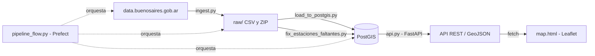

# EcoBici — Pipeline de Datos Geoespaciales

Pipeline de datos end-to-end sobre bicicletas públicas de Buenos Aires (EcoBici): ingesta, modelado geoespacial en PostGIS, orquestación automática, API con consultas espaciales reales, y visualización interactiva.

## Arquitectura



## Datos

- **Fuente**: portal de datos abiertos de la Ciudad de Buenos Aires ([data.buenosaires.gob.ar](https://data.buenosaires.gob.ar)).
- **Estaciones**: 407 del listado oficial vigente + 157 reconstruidas a partir de los propios viajes (estaciones dadas de baja o renumeradas durante 2025, ausentes del listado actual).
- **Viajes**: +3.100.000 viajes registrados durante 2025.

## Stack

| Capa | Tecnología |
|---|---|
| Almacenamiento | PostgreSQL + PostGIS (Docker) |
| Ingesta y transformación | Python, pandas, geopandas |
| Orquestación | Prefect |
| API | FastAPI + GeoAlchemy2 |
| Visualización | Leaflet |

## Cómo correrlo

```bash
docker compose up -d
python -m venv venv
venv\Scripts\activate        # En Mac/Linux: source venv/bin/activate
pip install -r requirements.txt
python pipeline_flow.py      # Descarga, carga y corrige los datos (~20 min)
uvicorn api:app --reload     # Deja este proceso corriendo
```

Con la API corriendo, abrí `map.html` directamente en el navegador (doble click).

## Endpoints de la API

| Endpoint | Descripción |
|---|---|
| `GET /estaciones` | Todas las estaciones en GeoJSON |
| `GET /estaciones/cerca?lat=&lon=&radio_m=` | Estaciones dentro de un radio (consulta espacial `ST_DWithin`) |
| `GET /viajes/top-estaciones` | Ranking de estaciones por cantidad de viajes |
| `GET /viajes/por-hora` | Distribución de viajes por hora del día |

Documentación interactiva completa en `/docs` una vez que el servidor está corriendo.

## Decisiones de diseño y desafíos reales

- **Firewall anti-bots**: el portal de datos abiertos rechaza pedidos sin headers de navegador. Se resolvió identificando el cliente HTTP con un User-Agent real y manteniendo una sesión con cookies.
- **Codificación inconsistente**: los CSV de origen no siempre vienen en UTF-8. La ingesta prueba varias codificaciones de forma robusta antes de fallar.
- **Dimensión con miembros tardíos**: ~940.000 viajes referenciaban estaciones ausentes del listado oficial vigente (dadas de baja o renumeradas durante el año). Se resolvieron reconstruyendo esas estaciones a partir del nombre y las coordenadas embebidos en el propio archivo de viajes, marcándolas como `inferida_de_viajes` para dejar la decisión documentada en los propios datos.
- **Idempotencia del pipeline**: un primer arreglo aplicado a mano en la base de datos (vía `ALTER TABLE`) no sobrevivió a una corrida completa del pipeline, porque la tabla se recrea en cada ejecución. La lección: cualquier corrección tiene que vivir en el código, no en la base, para ser reproducible.

## Próximos pasos posibles

- Deploy de la API a un hosting gratuito para tener un demo público.
- Sumar datasets adicionales (ciclovías, siniestros viales) para enriquecer el análisis.
- Filtros por fecha y franja horaria en el mapa.
